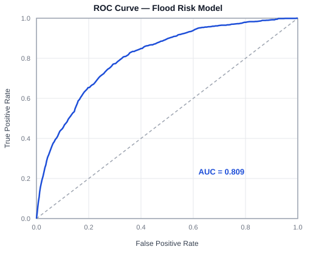

# Flood Risk Model — Test Results

Generated: 2026-10-26T18:19:40.297Z
Model trained: 2026-10-26T18:19:39.995Z (training window 1981-2020)

## 1. Data integrity

| Check | Result |
|---|---|
| DesInventar historical flood records loaded | 8182 |
| Year range covered | 1981-2020 |
| Distinct districts in raw data | 25 |
| Unmapped district names | None (all map to a known district) |

## 2. Model summary

| Metric | Value |
|---|---|
| Training samples | 12000 (1175 positive, 9.8%) |
| In-sample accuracy (0.5 threshold) | 90.4% |
| Top-decile precision | 37.9% vs. 9.8% base rate (3.9x) |

## 3. Confusion matrix (probability threshold = 0.5)

| | Predicted flood | Predicted no flood |
|---|---|---|
| **Actual flood** | TP = 140 | FN = 1035 |
| **Actual no flood** | FP = 121 | TN = 10704 |

| Metric | Value |
|---|---|
| Precision | 53.6% |
| Recall | 11.9% |
| F1 score | 19.5% |
| Accuracy | 90.4% |
| Baseline accuracy ("always predict no flood") | 90.2% |

**Reading this honestly**: raw accuracy is barely above the always-predict-negative baseline, because only ~10% of district-months in the training data ever had a reported flood — this is the same class-imbalance issue already documented for top-decile precision. Precision/recall/F1 at the 0.5 threshold are included here for completeness (a standard classification report), but the model's real, demonstrated skill is in *ranking* risk (top-decile precision, 3.9x the base rate), not in a binary yes/no call at 0.5.

## 3b. ROC curve and AUC

**AUC = 0.809** (0.5 = no better than random guessing, 1.0 = perfect ranking).

Unlike the confusion matrix above, ROC/AUC doesn't depend on picking one threshold — it evaluates the model's ability to rank a genuinely-flooded district-month above a non-flooded one, across every possible threshold at once. This is the standard way classification models are compared when the decision threshold is a design choice rather than a fixed requirement, and it's the metric most directly comparable to what a Random Forest or LSTM classifier in this same evaluation would report.

*(The dashed diagonal is the random-guess baseline (AUC = 0.5); the further the real curve bows toward the top-left corner, the better the model separates flood from non-flood months.)*

## 4. Domain-knowledge sanity checks

- **PASS**: Ratnapura (May) historical flood rate exceeds Mannar (February)
  - Ratnapura/May = 0.475, Mannar/February = 0.025
- **PASS**: Every district-month historical base rate is a valid probability [0,1]
- **PASS**: All trained weights and the bias are finite numbers (no NaN/Infinity — training didn't diverge)
  - weights = [0.8000, 0.3021, 0.0633, -0.0188], bias = -2.5941

## 5. Riskiest and safest district-months (qualitative check)

Real, interpretable output — the top 5 should read as genuinely flood-prone places/seasons to anyone familiar with Sri Lanka's geography, and the bottom 5 should read as genuinely dry.

**Riskiest:**
- Ampara, Dec: 62.5% of years had a reported flood
- Batticaloa, Dec: 50.0% of years had a reported flood
- Polonnaruwa, Dec: 47.5% of years had a reported flood
- Ratnapura, May: 47.5% of years had a reported flood
- Kalutara, May: 40.0% of years had a reported flood

**Safest:**
- Monaragala, Aug: 0.0% of years had a reported flood
- Monaragala, Jun: 0.0% of years had a reported flood
- Badulla, Aug: 0.0% of years had a reported flood
- Polonnaruwa, Sep: 0.0% of years had a reported flood
- Polonnaruwa, Aug: 0.0% of years had a reported flood

## Overall result: ALL CHECKS PASSED

---
*This is a dissertation-scope evaluation on in-sample data (not a held-out test set) — appropriate for demonstrating the model learned a real, sensible signal from real historical data, not a claim of production-grade forecasting accuracy. See CLAUDE.md's "Flood risk forecast (ML)" section for the full data-sources and limitations discussion.*
